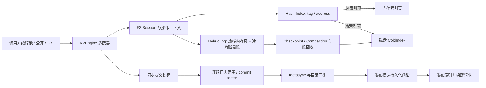

# 整体架构设计

本文描述当前 F2 实验候选的模块职责和请求路径。代码位于 `code/faster-native-adapter/`，SDK 接口与公开测试源码位于 `code/taycan_participant_sdk/`。分支 `experiment/f2-batch-takeover-20261124` 上的“凑满线程接手”仍是关闭的实验开关，不是默认策略，也没有合入主干。

## 目标与约束

目标是实现嵌入式磁盘 KV：Put/Delete 成功返回前，数据及索引变化必须到达持久化边界；启动时按 `mem_limit_bytes` 管理索引与缓存；索引可落盘并按需加载；正确处理并发、崩溃恢复和后台 Compaction。性能目标为 2 亿 Key、32 个调用线程、64 GiB Load 预算下至少 60,000 ops/s，并在 4/16 GiB 两档、32 线程、600 秒 60/30/10 混合负载下至少 50,000 ops/s。完整参数以命题文档与 `code/taycan_participant_sdk/evaluation-config.json` 为准。

## 模块关系



公开 API 仍是同步 `Get`、`Put`、`Delete`。调用方线程直接发起操作并等待返回；F2 内部另有 checkpoint/Compaction 工作，不把前台请求改写成网络服务式 reactor。适配器负责接口转换、打开参数和状态映射；哈希索引、记录布局、冷热索引及 HybridLog 操作由 F2 执行。

## 持久化写路径

Linux `data-log` 候选利用 F2 HybridLog 作为主要数据记录，不另存一份完整 Value WAL。每个提交组分配连续 serial 和 HybridLog 地址范围，将操作应用到 F2 并生成固定格式的 commit footer。footer 含范围、操作数和 CRC，用于恢复时区分完整提交组和尾部不完整数据。

数据文件完成写入后，对相关日志文件执行 `fdatasync`；首次创建段时还同步目录项。同步成功后推进 `stable_tail`/durable serial，发布索引并唤醒组内调用者。任何写入、同步或发布失败都会使实例失败关闭，不能继续对后续请求返回成功。恢复从持久 root/checkpoint 起点读取完整 footer 链，丢弃合法的不完整尾部并拒绝内部损坏。

批次收集是提交调度，不改变 API 的成功语义：组内每个请求都要等同一提交组完成同步和索引发布。现有基线由首个收集者提交；本分支新候选允许最后到达、凑满阈值的线程接手提交。后者缩短了满批交接时间，但实测总 Load 吞吐回退，故默认关闭。

## 索引与内存

F2 Hash Index 的槽位保存 tag 和记录地址。地址指向 HybridLog 中的记录，读取时先由 tag 快速过滤，再到对应热/冷记录位置读取完整 Key 并精确比较，处理哈希冲突。热索引页可驻留内存，冷索引页由 F2 的磁盘 ColdIndex 管理。`mem_limit_bytes` 是初始化索引规模和日志缓冲的输入；实际验收仍以进程 VmRSS 为准，不能把配置预算等同于 RSS 上限。

当前同步适配器的初始化近似为：

```text
entries = 4096
while entries < mem_limit_bytes / divisor: entries *= 2
divisor = 4096                         # 普通 data-log 构建
divisor = 65536                        # 编译开启 F2_DURABLE_COMPACTION
page_bytes = 1 << F2_LOG_PAGE_BITS     # 默认 1 MiB
log_memory = max(6 * page_bytes,
                 floor(mem_limit_bytes / 8 / page_bytes) * page_bytes)
```

`entries` 运行时依 Open 预算计算；`log_memory` 分别传给 F2 的热端和冷端日志配置，ReadCache 当前关闭。以 4 GiB、普通 data-log、默认页参数为例，桶数为 2^20，每端日志配置约 512 MiB；编译启用 durable compaction 后桶数计算目标改为 2^16。它们是配置参数，不等于进程真实驻留内存或两端实际同时占满的 RSS。

`F2_LOG_PAGE_BITS`、溢出页尺寸和记录格式仍由编译期确定，打开已有数据库时格式标记会校验配置；不能在同一构建中对每个 Open 改变页面几何。需要改变页尺寸应构建不同格式并单独验证迁移/兼容性。正确性和性能必须在 4 GiB、2 亿 Key 下实际观察 VmRSS、冷索引换入/换出和磁盘占用。

## Checkpoint、Compaction 与回收

Checkpoint 固化可恢复的索引状态及 HybridLog 前沿。新恢复点必须先完整写入、同步并原子发布；只有确认新恢复点不再依赖的旧日志/索引段才可删除。Compaction 后台扫描仍有效记录，构造新段和索引，再通过恢复根切换；失败时旧恢复点与文件仍需可恢复。SDK 的可选 Checkpoint 接口和并发快照语义仍需单独实现、测试。

当前构建通过 `TAYCAN_F2_DURABLE_COMPACTION` 显式启用耐久回收代码，默认关闭。正式提交需开启并通过公开 `compaction`、`compaction_crash`、内存限制及 2 亿 Key 稳态测试。没有通过这些测试前，不宣称磁盘空间回收和 crash-safe Compaction 完成。

## 代码与评测入口

- 引擎：`code/faster-native-adapter/`
- 官方接口、C++ 测试和共享 C++ workload：`code/taycan_participant_sdk/`
- 正确性入口：`script/taycan/tests/run_correctness.py`
- 性能入口：`script/taycan/benchmarks/run_performance.py`
- F2 故障/性能实验驱动：`script/f2/`
- 正式验收的 Linux 配置与限制：`docs/performance-status.md`

官方脚本按要求直接调用 KVEngine 的 Open、Get、Put、Delete 和 Destroy；Checkpoint 测试仅在实现可选能力后运行。通过公开脚本不替代未公开参数测试、RSS 监控、源码审查或正式规模性能门槛。
